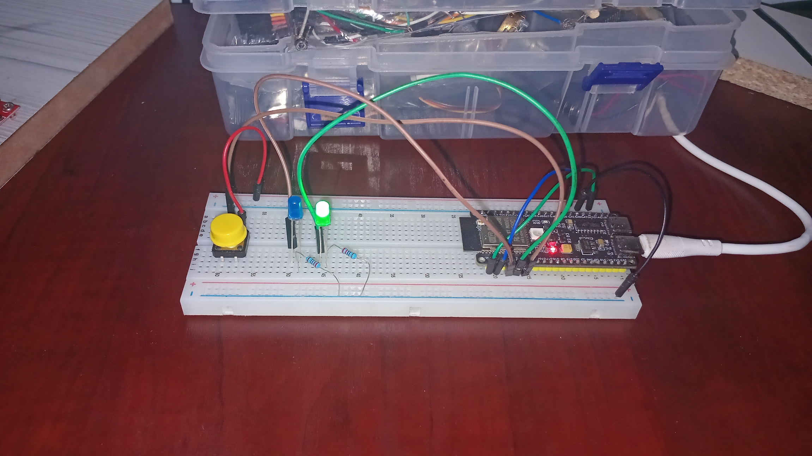
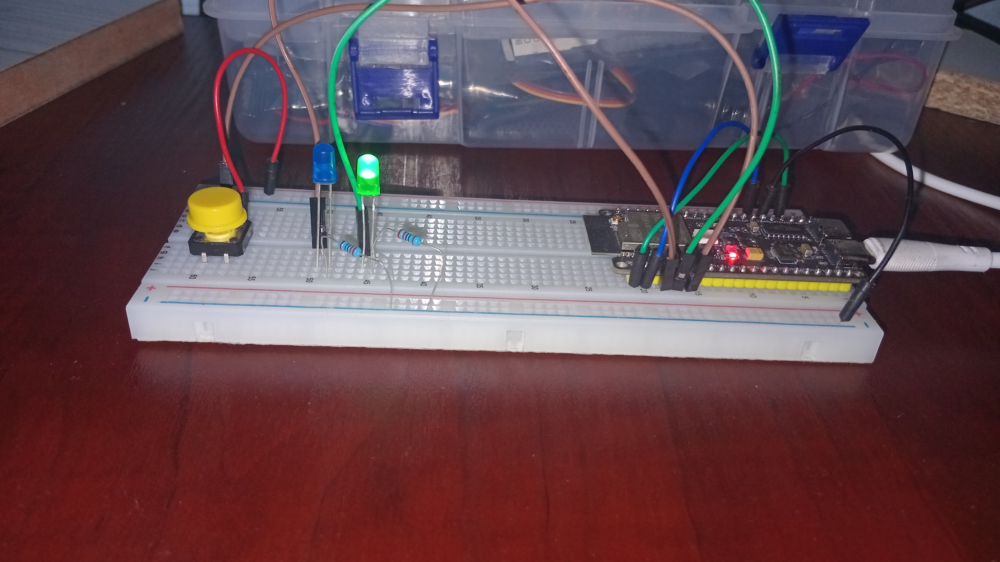

# ESP32 WiFi Connection Status

A beginner-friendly ESP32 project exploring Wi-Fi connectivity, connection monitoring, GPIO control, and LED status indicators using the Arduino framework.

## Overview

This project demonstrates how an ESP32 microcontroller connects to a Wi-Fi network and monitors its connection status.

Two LEDs provide visual feedback about the Wi-Fi connection, while a push button allows the user to disconnect the ESP32 from the network.

## Features

- Connects to a Wi-Fi network using the ESP32 Wi-Fi library.
- Monitors Wi-Fi connection status.
- Displays connection information through the Serial Monitor.
- Uses two LEDs to indicate Wi-Fi connectivity.
- Uses a push button to trigger Wi-Fi disconnection.
- Implements a connection timeout to prevent endless connection attempts.

## Hardware Components

- ESP32 development board
- 2 LEDs
- 2 current-limiting resistors
- Push button
- Breadboard
- Jumper wires
- USB cable

## GPIO Configuration

| Component | ESP32 GPIO |
|---|---|
| Push Button | GPIO 6 |
| LED 1 | GPIO 5 |
| LED 2 | GPIO 4 |

**Button configuration:** `INPUT_PULLDOWN`

## How It Works

### 1. Wi-Fi Connection

When the ESP32 starts, it attempts to connect to the configured Wi-Fi network using `WiFi.begin()`.

### 2. Connection Monitoring

The program checks the Wi-Fi connection status and displays relevant messages through the Serial Monitor.

When successfully connected, it displays the assigned IP address.

### 3. LED Indicators

The two LEDs indicate the current Wi-Fi connection state.

| Wi-Fi Status | LED 1 (GPIO 5) | LED 2 (GPIO 4) |
|---|---|---|
| Connected | ON | OFF |
| Disconnected | OFF | ON |

### 4. Button-Controlled Disconnection

When the push button is pressed, the ESP32 executes `WiFi.disconnect()` to disconnect from the network.

## Project Gallery

### Hardware Setup

*ESP32 development board with connected LEDs and push button.*

### Wi-Fi Connection Status

*Visual demonstration of the ESP32 Wi-Fi connection status.*

## Development Environment

- Arduino Framework
- Arduino IDE / PlatformIO
- C++
- ESP32 Wi-Fi Library

## Project Purpose

This project is part of my hands-on journey into embedded systems development.

The objective is to understand fundamental microcontroller operations, including:

- Wi-Fi connectivity.
- GPIO input and output.
- Digital signal reading.
- Hardware control through software.
- Serial communication.
- Basic network status monitoring.

## Future Improvements

- Implement automatic Wi-Fi reconnection.
- Add button debounce functionality.
- Replace blocking delays with `millis()`.
- Introduce a more structured Wi-Fi connection management system.
- Add an OLED display for connection information.

---

**Status:** Work in Progress

**Platform:** ESP32

**Framework:** Arduino